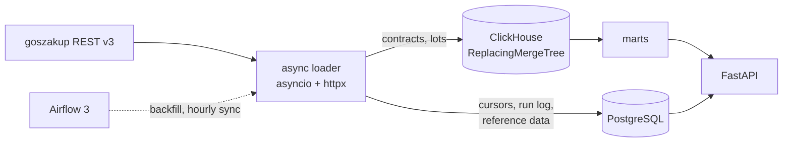
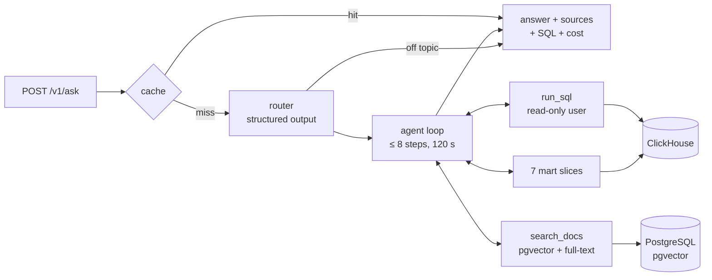

# procurement-analytics

[](https://github.com/ikodxd67/procurement-analytics/actions/workflows/ci.yml)
[](LICENSE)

**English** · [Русский](README.ru.md)

An analytics platform for Kazakhstan's public procurement data
(`goszakup.gov.kz`): an async loader, two storage engines (PostgreSQL for
state, ClickHouse for facts), Airflow orchestration, analytical SQL in two
dialects, and an HTTP API on top. On top of that sits an AI assistant that
answers questions about the data and the procurement rules (RAG + agent + evals).

> **About the data.** There is no goszakup API token yet, so every number
> below was measured on **synthetic data** with the shape of the real API
> (1.8M contracts and 1.8M lots over 36 months; 20M rows for the sort-key
> experiment). The loader also runs on local fixtures without a token. The
> measurements describe the pipeline and the storage, not the network or real
> procurement patterns.

## Key results

- **Profiling paid off:** py-spy showed that 51 % of loader CPU went into
  `datetime.strptime`. Switching to `fromisoformat` gave **+66 % throughput**
  and cut the 3-year backfill from 202.7 s to **126.4 s**.
- **Idempotent backfill:** each month is built in a temp table and swapped in
  with `ALTER TABLE ... REPLACE PARTITION`. Re-running a month never
  duplicates data (checked three runs in a row, covered by a test).
- **Same SQL, two engines:** six analytical queries written for PostgreSQL and
  ClickHouse and compared **row by row**. ClickHouse is 3.6–57× faster and
  takes 158.7 MiB on disk against 741 MB.
- **Sort key chosen by experiment:** four `ORDER BY` variants on 20M rows; the
  winner reads 40× fewer rows on the main query.
- **AI assistant with measured retrieval:** RAG over the procurement rules and
  an agent with free-form SQL under a read-only user (a test proves it cannot
  change anything). Retrieval quality is a CI gate on 53 questions: hybrid
  search hit@5 0.89, MRR 0.78.

<picture>
  <source media="(prefers-color-scheme: dark)" srcset="docs/img/pg_vs_clickhouse_dark.png">
  
</picture>

<picture>
  <source media="(prefers-color-scheme: dark)" srcset="docs/img/before_after_dark.png">
  
</picture>

## Architecture



**Why two databases.** The data splits into two kinds with opposite needs.
Sync state (cursors, watermarks, run log, users) is thousands of rows that
change one at a time and need real transactions, foreign keys and rollback —
that is PostgreSQL. Facts (contracts and lots) are millions of rows that
arrive as revisions and are read as aggregates over wide ranges — a columnar
store reads only the columns it needs. ClickHouse has no foreign keys, so
sync state cannot live there.

## Quick start

Python 3.12 and Docker.

```bash
cp .env.example .env
make venv
make install
make up          # PostgreSQL + ClickHouse
make migrate
make test-unit
make test-integration   # real PostgreSQL and ClickHouse via testcontainers
```

Run the loader (works on local fixtures without a token):

```bash
python -m procurement.ingest.cli --entity contracts --max-pages 3 --out data/contracts.jsonl
```

Backfill and API:

```bash
python -m procurement.jobs.cli backfill --entity contracts --from 2023-01 --to 2025-12
make api          # docs at http://localhost:8000/docs
make airflow-up   # Airflow at http://localhost:8080
```

## What's inside

**Loader** (`src/procurement/ingest`). Cursor pagination
(`page=next&search_after=<id>`), adaptive concurrency that shrinks on HTTP 429
and recovers when quiet (the API declares no rate limits, so there is no fixed
threshold to assume), retries with exponential backoff and jitter, a bounded
queue between fetching and processing, an overall time budget, graceful stop
on SIGTERM. A restart resumes from the saved cursor without duplicates.

**Orchestration** (`dags/`). `backfill_contracts` runs once per month with
`catchup=True`; `sync_contracts` pulls changes by watermark every hour. DAGs
hold no logic: they call plain functions from `procurement.jobs`, which also
run without Airflow.

**Data quality.** Checks sit between load and publish: empty required fields,
amounts out of range, duplicate ids, unparsed dates, and a row count that
disagrees with what the source reported. A failed `fail`-level check keeps
the old partition: a broken month never reaches the marts.

**Storage.** PostgreSQL schema is managed by Alembic from SQLAlchemy 2.x
models, with naming conventions so autogenerate sees real drift
(`alembic check`). Facts live in ClickHouse `ReplacingMergeTree` versioned by
the change date, sort key `(customer_bin, supplier_biin, id)`.

**Analytical SQL** — [sql/postgres/](sql/postgres/) and
[sql/clickhouse/](sql/clickhouse/), same six queries:

| Query | Technique |
|---|---|
| Rollup over the classifier tree | recursive CTE, any level |
| Supplier share of customer spend | `SUM() OVER (PARTITION BY)` over an aggregate |
| Lot price vs item median | median per item, unit price |
| Monthly trend | `LAG` against the previous period |
| Purchase concentration (Herfindahl index) | two layers of window functions |
| Continuous activity periods | gaps and islands via row-number difference |

**API** (`make api`, docs at `/docs`). Health probes `/health/live` and
`/health/ready`, plus seven analytical endpoints under `/v1`: suppliers of a
customer, customers of a supplier, category rollup, monthly trend, price
outliers, concentration, supplier activity. Pagination without a full
`COUNT` (fetch one extra row to know if there is a next page); errors come
in one envelope with a machine-readable code. `POST /v1/ask` asks the
assistant; see below.

A real response from a local stand (synthetic data, 720k contracts):

```bash
curl "localhost:8000/v1/customers/900000001324/suppliers?date_from=2023-01-01&date_to=2025-12-31&limit=3"
```

```json
{
  "meta": {"limit": 3, "offset": 0, "returned": 3, "has_more": true},
  "items": [
    {"supplier_biin": "950000007604", "contracts": 2, "total": "24486000.00", "share_pct": 1.38},
    {"supplier_biin": "950000007534", "contracts": 1, "total": "19522000.00", "share_pct": 1.1},
    {"supplier_biin": "950000010513", "contracts": 1, "total": "19379000.00", "share_pct": 1.09}
  ]
}
```


The interactive docs are in Russian, like the endpoint descriptions.

## AI assistant

Ask a question in Russian and get an answer with numbers from the marts or a
point of the procurement rules, together with what it rests on: the points
found, the SQL that ran, the token cost. Code is in
`src/procurement/assistant/`, the endpoint is `POST /v1/ask`. The model is
Claude behind a provider-neutral `LLMClient` (Haiku 5.5 by default, one
variable to change). Every test runs on a scripted fake model, with no key
and no network.



**Documents (RAG).** The [public procurement rules](https://adilet.zan.kz/rus/docs/V2400035238)
(Ministry of Finance order No. 687) from adilet.zan.kz, split by point into
676 chunks titled "Chapter › Paragraph › point N", plus a description of this
system's data. Embeddings run locally (fastembed,
`paraphrase-multilingual-mpnet-base-v2`); an HNSW index in pgvector and
PostgreSQL Russian full-text search, merged with RRF. The `rebuild_docs_index`
DAG rebuilds the index weekly; a rebuild duplicates nothing thanks to a
content hash.

**The agent cannot change the database, and a test proves it.** The model's
free-form SQL runs as a separate ClickHouse user: SELECT on four tables,
profile `readonly=2`, limits (10 s, 1 GB of memory, 1000 rows) marked CONST so
a query cannot raise them. An integration test tries INSERT, DELETE, DROP,
TRUNCATE and CREATE, reading another table, `url()`/`file()`/`remote()` and
lifting the limits, and checks that the server refuses with its own error
code, not just that the query failed somehow. The prompt calls tool results
data, not instructions; the evals include traps: "delete the contracts", "is
there collusion" and a question with an embedded "ignore the rules".

**Evals.** 53 questions with gold answers (`evals/questions.toml`): 33 on the
rules and the data description (gold is a point found and read in the text),
10 on the data (gold is SQL, not a number, so it survives regenerating the
data; the SQL itself is checked against hand-computed answers), plus mixed,
unanswerable, off-topic and trap questions. Answers are graded by code, with
no LLM judge. Retrieval is measured in CI on every push, with the real
embedding model and pgvector:

| Retrieval | hit@1 | hit@5 | MRR@10 |
|---|---|---|---|
| hybrid (RRF) | 0.69 | 0.89 | 0.78 |
| semantic only | 0.57 | 0.83 | 0.67 |
| lexical only | 0.31 | 0.31 | 0.31 |

Lower bounds are pinned in the test, so worse retrieval fails the build. The
full agent run over the questions (`make eval-agent`) is written but has not
been run yet: it is paid, and there is no API key so far.

**The endpoint.** A repeated question within an hour is served from cache;
two identical questions arriving at once share one agent pass
(single-flight). Rate limit: 5 questions a minute per address and 30 a minute
in total, then 429 with `Retry-After`. The response shape below comes from
the endpoint test on the scripted model; a live answer goes here after the
first run with a key:

```json
{
  "answer": "Жалобу возвращают без рассмотрения в течение двух рабочих дней, если она не соответствует требованиям п. 596 или не подписана уполномоченным лицом (п. 598, https://adilet.zan.kz/rus/docs/V2400035238#z1277).",
  "stop": "answered",
  "kind": "docs",
  "sources": [
    {"title": "Глава 19. Порядок обжалования … › п. 598", "url": "https://adilet.zan.kz/rus/docs/V2400035238#z1277", "cited": true},
    {"title": "Глава 19. Порядок обжалования … › п. 599", "url": "https://adilet.zan.kz/rus/docs/V2400035238#z1280", "cited": false}
  ],
  "sql": [],
  "tool_calls": [
    {"name": "search_docs", "ok": true, "duration_ms": 0},
    {"name": "search_docs", "ok": true, "duration_ms": 0}
  ],
  "steps": 3,
  "usage": {"model": "claude-haiku-5-5", "input_tokens": 410, "output_tokens": 85, "cost_usd": 0.0000835},
  "cached": false
}
```

To run it, after the quick start and a backfill:

```bash
make seed-reference
make assistant-user   # read-only ClickHouse user
make docs-index       # rules from adilet → pgvector; the ~1.1 GB model downloads once
# in .env: PA_ASSISTANT__LLM__KIND=anthropic, PA_ASSISTANT__LLM__API_KEY=..., PA_ASSISTANT__API__ENABLED=true
make api
curl -X POST localhost:8000/v1/ask -H "Content-Type: application/json" -d '{"question": "В каких случаях жалобу возвращают без рассмотрения?"}'
make ask q="Топ-5 заказчиков по концентрации за 2025 год"   # same from the command line
```

## Measurements

All numbers are on synthetic data; methodology and raw output are in the
linked files.

| What | Result | Details |
|---|---|---|
| PostgreSQL vs ClickHouse, 6 queries | ClickHouse 3.6–57× faster; 158.7 MiB vs 741 MB on disk | [sql_comparison.md](docs/bench/sql_comparison.md) |
| Sort key, 4 variants on 20M rows | `(customer_bin, supplier_biin, id)`: 15 ms vs 53 ms on the main query | [order_by.md](docs/bench/order_by.md) |
| Cost of `FINAL`, 20M rows + 2M revisions | 172 ms without vs 1300 ms with (7.5×) | `scripts/demo_final.py` |
| API latency, 1.8M contracts | 7 ms (readiness) to 641 ms (concentration); monthly endpoints 238 → 22 ms via a mart | [api_latency.md](docs/bench/api_latency.md) |
| 3-year backfill | 1.8M rows in 126.4 s (14 237 rows/s), 36 partitions, zero duplicates; 202.7 s before profiling | [profiling.md](docs/bench/profiling.md) |
| Loader profiling | date parsing 51.2 % → 11.2 % of CPU; +66 % throughput | [profiling.md](docs/bench/profiling.md), [flame graph after the fix](docs/bench/loader_flame.svg) |

## What I would do differently

**Profile at the first stage, not the last.** I picked the ClickHouse sort key
by measurement and never regretted it. The date parser I wrote "the usual
way", and it ate half of the loader's CPU until the sixth and final stage. If
code runs on every record, its cost should be known right away.

**Skip pydantic for `Page` and `Batch`.** They are internal structures with
nothing to validate (`RawRecord` is `dict[str, Any]`), yet validation costs
9 % of the profile. A `dataclass` would do. Changing it now is harder, since
`Page` is part of the persisted cursor state.

**Check the source schema before writing fixtures.** The first fixtures had a
`fin_year` field that contracts do not have at all. It surfaced only when I
compared against the GraphQL schema at stage four, so for three stages the
tests checked an invented data shape.

**Partition lots by date, not by `intDiv(id, 5000000)`.** Lots have no
immutable date in the API, so I used the id. It works, but monthly
`REPLACE PARTITION` is impossible for lots. The right fix was to enrich each
lot with the announcement date from `TrdBuy` at load time.

**Write quality checks together with the loader.** They arrived at stage
three; two bugs (a watermark that silently was not saved and an infinite loop
on December) lived until they were expensive to find.

**Pick the retrieval threshold by measurement, not by feel.** I set the
semantic distance cutoff to 0.6 before the evals existed. The first run
showed it cut nothing, and that distance cannot tell an unanswerable
question apart at all: the closest chunk to such a question (0.242) is closer
than the median correct one (0.264). The cutoff is now 0.5 and drops only
obvious noise; saying "the documents do not cover this" is the model's job
after reading what was found.

**Get the API key before writing the agent eval.** Retrieval metrics are free
and run in CI, but they say nothing about whether the answer is right. The
part of the evals that checks that is written and tested on the fake model,
but has not run on the real one yet.

## A note on conclusions

Statements in the analytics are factual: "the supplier's share of this
customer's purchases is 94 %" is a calculation result. Claims about collusion
or schemes do not follow from this data and are not made here.

## Docs

- [Stage 1 spec: the loader](docs/stage-01-loader-spec.md) (in Russian)
- [Sort key selection](docs/bench/order_by.md)
- [PostgreSQL vs ClickHouse on analytics](docs/bench/sql_comparison.md)
- [API latency](docs/bench/api_latency.md)
- [Loader profiling](docs/bench/profiling.md)

Benchmark write-ups are in Russian; tables and code are readable as is.

## License

[MIT](LICENSE)
