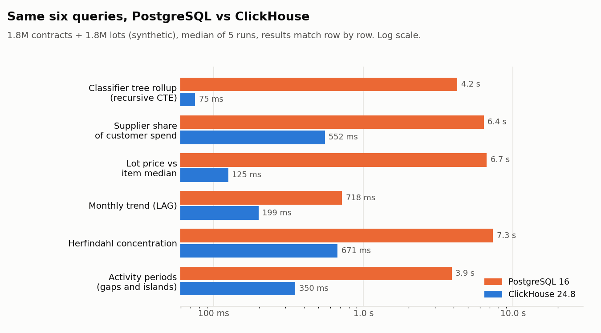
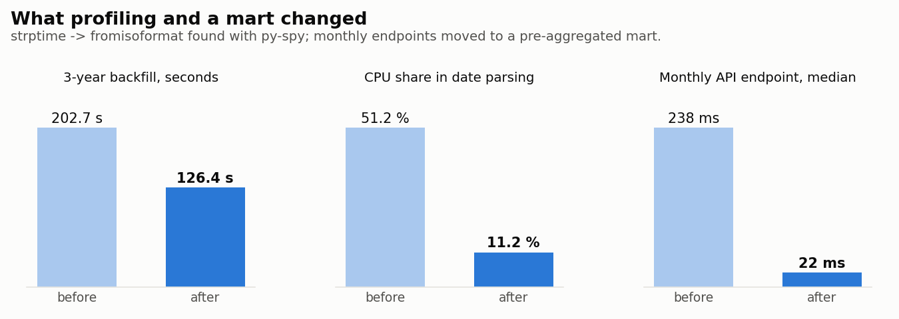
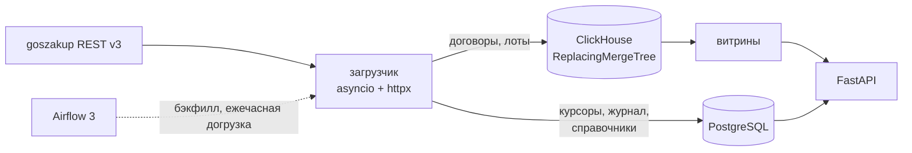
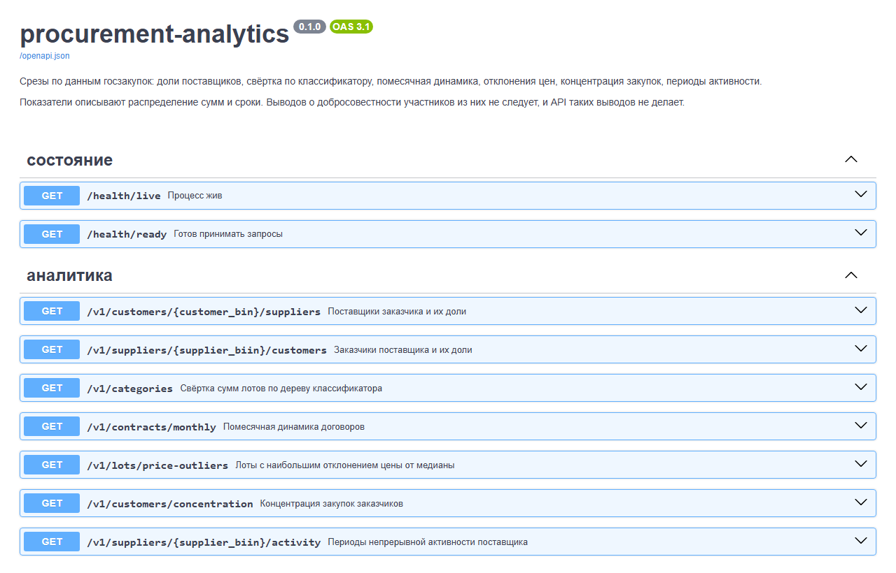

# procurement-analytics

[](https://github.com/ikodxd67/procurement-analytics/actions/workflows/ci.yml)
[](LICENSE)

[English](README.md) · **Русский**

Аналитическая платформа по открытым данным госзакупок Казахстана
(`goszakup.gov.kz`): асинхронный загрузчик, два хранилища (PostgreSQL для
состояния, ClickHouse для фактов), оркестрация на Airflow, аналитический SQL в
двух диалектах и HTTP API поверх них.

> **Про данные.** Токена goszakup пока нет, поэтому все цифры ниже получены
> на **синтетических данных** в форме настоящего API (1,8 млн договоров и
> 1,8 млн лотов за 36 месяцев; 20 млн строк в эксперименте с ключом
> сортировки). Без токена загрузчик работает на локальных фикстурах. Замеры
> относятся к конвейеру и хранилищам, а не к сети и не к реальной картине
> закупок.

## Главное

- **Профилирование окупилось:** py-spy показал, что 51 % процессорного
  времени загрузчика уходит на `datetime.strptime`. Замена на `fromisoformat`
  дала **+66 % пропускной способности**, бэкфилл за 3 года сократился с
  202,7 с до **126,4 с**.
- **Идемпотентный бэкфилл:** месяц собирается во временной таблице и въезжает
  в боевую через `ALTER TABLE ... REPLACE PARTITION`. Повторный прогон месяца
  не задваивает данные (проверено тремя прогонами подряд, закреплено тестом).
- **Один SQL — два движка:** шесть аналитических запросов для PostgreSQL и
  ClickHouse, результаты сверяются **построчно**. ClickHouse быстрее в
  3,6–57 раз и занимает на диске 158,7 МиБ против 741 МБ.
- **Ключ сортировки выбран экспериментом:** четыре варианта `ORDER BY` на
  20 млн строк; победитель на основном запросе читает в 40 раз меньше строк.

<picture>
  <source media="(prefers-color-scheme: dark)" srcset="docs/img/pg_vs_clickhouse_dark.png">
  
</picture>

<picture>
  <source media="(prefers-color-scheme: dark)" srcset="docs/img/before_after_dark.png">
  
</picture>

## Архитектура



**Почему две базы.** Данные распадаются на два вида с противоположными
требованиями. Состояние синхронизации (курсоры, водяные знаки, журнал,
пользователи) — тысячи строк, которые меняются по одной и требуют честных
транзакций, внешних ключей и отката: это PostgreSQL. Факты (договоры и лоты) —
миллионы строк, которые приходят ревизиями и читаются агрегатами по большим
диапазонам: колоночное хранилище читает только нужные колонки. Во ClickHouse
нет внешних ключей, поэтому состояние синхронизации там жить не может.

## Быстрый старт

Нужны Python 3.12 и Docker.

```bash
cp .env.example .env
make venv
make install
make up          # PostgreSQL + ClickHouse
make migrate
make test-unit
make test-integration   # настоящие PostgreSQL и ClickHouse через testcontainers
```

Загрузчик (без токена работает на локальных фикстурах):

```bash
python -m procurement.ingest.cli --entity contracts --max-pages 3 --out data/contracts.jsonl
```

Бэкфилл и API:

```bash
python -m procurement.jobs.cli backfill --entity contracts --from 2023-01 --to 2025-12
make api          # документация на http://localhost:8000/docs
make airflow-up   # Airflow на http://localhost:8080
```

## Что внутри

**Загрузчик** (`src/procurement/ingest`). Курсорная пагинация
(`page=next&search_after=<id>`), адаптивная конкурентность: сжимается на
HTTP 429 и восстанавливается в тишине (API не декларирует рейт-лимиты, так что
известного порога нет). Повторы с экспоненциальной паузой и джиттером,
очередь с ограничением размера между загрузкой и обработкой, общий бюджет
времени, мягкая остановка по SIGTERM. Перезапуск продолжает с сохранённого
курсора без дублей.

**Оркестрация** (`dags/`). `backfill_contracts` — один запуск на месяц,
`catchup=True`; `sync_contracts` — догрузка изменений по водяному знаку
ежечасно. Логики в DAG-ах нет: они вызывают обычные функции из
`procurement.jobs`, которые работают и без Airflow.

**Проверки качества** стоят между загрузкой и публикацией: пустые
обязательные поля, суммы вне диапазона, дубли по id, нераспознанные даты,
расхождение с числом записей, заявленным источником. Не прошла проверка
уровня `fail` — партиция не подменяется, испорченный месяц до витрин не
доезжает.

**Хранилища.** Схема PostgreSQL ведётся Alembic из моделей SQLAlchemy 2.x;
имена ограничений заданы соглашением, поэтому автогенерация видит настоящий
дрейф (`alembic check`). Факты лежат в ClickHouse в `ReplacingMergeTree` с
версией по дате изменения, ключ сортировки `(customer_bin, supplier_biin, id)`.

**Аналитический SQL** — [sql/postgres/](sql/postgres/) и
[sql/clickhouse/](sql/clickhouse/), одни и те же шесть запросов:

| Запрос | Приём |
|---|---|
| Свёртка по дереву классификатора | рекурсивный CTE, свёртка на любой уровень |
| Доля поставщика в закупках заказчика | `SUM() OVER (PARTITION BY)` поверх агрегата |
| Отклонение цены лота от медианы позиции | медиана по товарной позиции, цена за единицу |
| Помесячная динамика | `LAG` для сравнения с предыдущим периодом |
| Концентрация закупок (индекс Херфиндаля) | два этажа оконных функций |
| Периоды непрерывной активности | gaps and islands через разность номеров |

**API** (`make api`, документация на `/docs`). Пробы `/health/live` и
`/health/ready` и семь аналитических ручек под `/v1`: поставщики заказчика,
заказчики поставщика, свёртка по классификатору, помесячная динамика,
отклонения цен, концентрация, активность поставщика. Пагинация без `COUNT` по
всей выборке (запрашивается на одну запись больше, по ней видно, есть ли
следующая страница); ошибки приходят в едином конверте с машиночитаемым кодом.

Настоящий ответ с локального стенда (синтетические данные, 720 тыс. договоров):

```bash
curl "localhost:8000/v1/customers/900000001324/suppliers?date_from=2023-01-01&date_to=2025-12-31&limit=3"
```

```json
{
  "meta": {"limit": 3, "offset": 0, "returned": 3, "has_more": true},
  "items": [
    {"supplier_biin": "950000007604", "contracts": 2, "total": "24486000.00", "share_pct": 1.38},
    {"supplier_biin": "950000007534", "contracts": 1, "total": "19522000.00", "share_pct": 1.1},
    {"supplier_biin": "950000010513", "contracts": 1, "total": "19379000.00", "share_pct": 1.09}
  ]
}
```



## Замеры

Все цифры — на синтетических данных; методика и сырой вывод — по ссылкам.

| Что | Результат | Подробно |
|---|---|---|
| PostgreSQL против ClickHouse, 6 запросов | ClickHouse быстрее в 3,6–57 раз; 158,7 МиБ против 741 МБ на диске | [sql_comparison.md](docs/bench/sql_comparison.md) |
| Ключ сортировки, 4 варианта на 20 млн строк | `(customer_bin, supplier_biin, id)`: 15 мс против 53 мс на основном запросе | [order_by.md](docs/bench/order_by.md) |
| Цена `FINAL`, 20 млн строк + 2 млн ревизий | 172 мс без него против 1300 мс с ним (в 7,5 раза) | `scripts/demo_final.py` |
| Задержки API, 1,8 млн договоров | от 7 мс (проба готовности) до 641 мс (концентрация); помесячные ручки 238 → 22 мс за счёт витрины | [api_latency.md](docs/bench/api_latency.md) |
| Бэкфилл за 3 года | 1,8 млн строк за 126,4 с (14 237 строк/с), 36 партиций, ноль дублей; до профилирования 202,7 с | [profiling.md](docs/bench/profiling.md) |
| Профилирование загрузчика | разбор дат 51,2 % → 11,2 % процессорного времени; +66 % пропускной способности | [profiling.md](docs/bench/profiling.md), [флеймграф после правки](docs/bench/loader_flame.svg) |

## Что бы я сделал иначе

**Профилировал бы на первом этапе, а не на последнем.** Ключ сортировки в
ClickHouse я выбирал замером и не пожалел. А разбор дат написал «как принято»,
и он съедал половину процессорного времени загрузчика вплоть до шестого,
последнего этапа. Если код выполняется на каждой записи, его цену надо узнать
сразу.

**Не брал бы pydantic для `Page` и `Batch`.** Это внутренние структуры,
проверять в них нечего (`RawRecord` — это `dict[str, Any]`), а валидация
стоит 9 % профиля. `dataclass` хватило бы. Менять сейчас дороже: `Page`
попадает в сохраняемое состояние курсора.

**Сверялся бы со схемой источника до написания фикстур.** В первых фикстурах
было поле `fin_year`, которого у договоров нет вовсе. Ошибка вскрылась только
на сверке с GraphQL-схемой на четвёртом этапе, то есть три этапа тесты
проверяли выдуманную форму данных.

**Партиционировал бы лоты по дате, а не по `intDiv(id, 5000000)`.** У лотов в
API нет ни одной неизменной даты, и я взял идентификатор. Работает, но
`REPLACE PARTITION` по месяцам для лотов невозможен. Правильный путь —
обогащать лот датой объявления из `TrdBuy` при загрузке.

**Писал бы проверки качества вместе с загрузчиком.** Они появились на третьем
этапе, и две ошибки (водяной знак, который молча не сохранялся, и бесконечный
цикл на декабре) дожили до момента, когда их стало дороже искать.

## Оговорка по выводам

Формулировки в аналитике фактические: «доля поставщика в закупках заказчика —
94 %» — это результат расчёта. Утверждения о сговоре или схемах из этих данных
не следуют и в проекте не делаются.

## Документация

- [Этап 1 — ТЗ на загрузчик](docs/stage-01-loader-spec.md)
- [Выбор ключа сортировки](docs/bench/order_by.md)
- [PostgreSQL против ClickHouse на аналитике](docs/bench/sql_comparison.md)
- [Задержки API](docs/bench/api_latency.md)
- [Профилирование загрузчика](docs/bench/profiling.md)

## Лицензия

[MIT](LICENSE)
